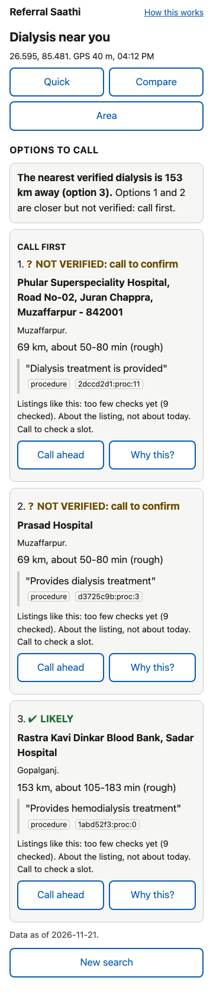

# Referral Saathi

A health worker in rural India types a service (dialysis, emergency caesarean, accident care) and gets whom to call
first, two backups and the one question to ask on the phone, each with the facility's own words as evidence and
how sure we are, in plain language. The facility list we were given was messy; the one the app uses is much
cleaner (duplicates removed, map points and states repaired, see Limits). What remains is mostly service claims
nobody can verify from the web, plus phone and hours facts no listing carries. So the app says "call to confirm"
instead of guessing, and it keeps working offline on a cheap phone.

**Not the nearest, and not an unreachable "best".** Sending everyone to the closest listing ignores whether it
really offers the care; sending everyone to the best hospital ignores whether the patient can get there in time.
Referral Saathi weighs evidence, travel time and the care's time window, and when the right hospital is too far it
plans a stop to stabilise first. For example, after a road accident near Pusa, Bihar, going straight to a trauma
hospital takes about 80 minutes and misses the 60-minute window, so the app sends the patient first to a hospital
about 34 minutes away, with the number to call and the question to ask. *These numbers come from the route planner
on model v2 (the hospital direct is Ganpati Hospital, Vaishali; the first stop is Miracare Hospital).*



The submission is three things:

- **Video demo:** the app on a phone, start to finish. Link to come (#12).
- **This repository**, with the code for every step from audit to app.
- **The notebook**, with all our code and its outputs:
  [`submission/referral_saathi.ipynb`](submission/referral_saathi.ipynb). It is readable on GitHub as is, and runs
  on Databricks Free Edition ([`submission/README.md`](submission/README.md)).

The app itself runs on Databricks Apps in the team workspace, as shown in the video. Its "How this works" page
tells the same story as the notebook, in plain words.

## How it works

```
provided facility table (Databricks Marketplace, 9,959 usable records)
  -> audit/        what is wrong: merged records, misplaced map points, copied sentences, shared phones
  -> cleaning/     fix what can be fixed, flag the rest; split every listing into sentences with ids
  -> derived/v1/   cleaned tables + a score with an interval for every data point (pipelines/source_scoring)
  -> kb/           taxonomy of services, care pathways, website crawl and open-data witnesses
  -> model/        evidence grades, source reliability, scores for "exists", "is here", "offers it"
  -> app/          FastAPI + one plain HTML page: whom to call, WHY (quotes) and HOW (points), offline packs
     planner/      multi-stop routes for time-critical cases (stabilise first, then definitive care)
     geo/          travel-time estimates, with hill-road factors by state
```

At request time the app needs only the Python standard library plus FastAPI. Its data exports are built from
`derived/v1` in a few seconds.

## Reproduce

**On Databricks Free Edition:**
1. Install the Marketplace listing.
2. Add this repository as a Git folder.
3. Open `submission/referral_saathi.ipynb`, attach serverless compute, and Run all.
   - If your catalog has a different name, set `CATALOG` in its first code cell.
   - Details are in `submission/README.md`.

**Locally** (Python 3.11+, a venv with pandas, pyarrow, fastapi, uvicorn and pytest):

```
make app-data     # planner export, facts, offline packs, "How this works" data (from derived/v1)
make test         # app, planner and travel tests
make serve        # http://127.0.0.1:8000
make notebook     # re-run the submission notebook and save it with outputs
make help         # everything else: a11y check, data audit, public copy, deploy (lead only)
```

`make derived` rebuilds `derived/v1` itself. It needs the raw dataset under `data/raw/` (not in git) and the
upstream cleaning steps; see `derived/v1/README.md`.

## Map of the repository

| Folder | What is in it |
| --- | --- |
| `app/` | The Databricks App: API, page, service worker, offline packs, faithfulness and accessibility tests |
| `planner/`, `geo/` | Multi-stop referral planner; travel-time estimates |
| `audit/` | The data audit: each finding with its hand check (`REPORT.md` summarises it) |
| `cleaning/` | Location and identity cleaning; sentence attribution and service grades |
| `pipelines/` | Builds `derived/v1` (source reliability and data-point scores) |
| `derived/v1/` | The cleaned tables every other part reads |
| `kb/` | Service taxonomy, care pathways, website crawl, open-data matches |
| `external/` | Fetch and join code for 14 public lists, with licence notes |
| `model/` | Model spec, prototypes, gold labels, the statistical review |
| `app_design/`, `design/`, `research/` | Product spec, feasibility probes, concept notes, dataset research |
| `submission/` | The notebook and its builder |
| `demo/` | Storyboard, narration script and the Playwright capture for the video |
| `tools/` | Deploy script, data audit, public-copy script |

## Results, honestly

- **The data problem** (`REPORT.md`, hand-checked):
  - 2,489 of 9,959 records (25.0%) carry a sentence that names another facility; in 1,232 it is written as if
    about the record itself, and cleaning quarantines it as evidence;
  - 1,367 of 9,869 map points are more than 50 km from their own PIN code (1,101 more than 100 km).
- **The model** (`derived/v2/model_card.json`): A_platt, an expert-set scorecard with one calibration step. On
  221 DEV pairs (168 confirmed), grouped five-fold out of fold: AUROC 0.800 [0.720, 0.867], log loss 0.427
  [0.352, 0.515] against 0.557 for a constant base rate, ECE 0.044. Labels are agent-made from public web pages,
  not human-checked; the sealed TEST set was opened once, after the model was frozen.
- **Likely:** 102 of 120 DEV pairs labelled Likely were confirmed [0.775, 0.903]. Of the 7,980 facility-service
  pairs the app serves, 4,507 are Likely; the rest say "call to confirm", "no service text: call to ask" or
  "Unlikely".
  On the sealed TEST labels, 25 of the 28 Likely pairs with a verdict were confirmed (0.893 [0.728, 0.963],
  `model/gold/v3/test_eval/results.json`). Every option still says to call first, and when nothing is Likely the
  app says so.
- **Top two:** a confirmed place was among the first 2 options in 27 of 27 emergency and 19 of 20 planned-care
  DEV groups, but a random order does nearly as well (0.97), so this says little about live queries.
- **Public facilities:** on 31 labelled public pairs (3 contradicted) we could not show that the score ranks public
  facilities better than chance; the sample is too small to tell.
- **What did not work** in the earlier prototype is listed in `model/MODEL_SPEC.md` section 4.11 and on the app's
  "How this works" page, as history. Its numbers are not comparable with the DEV numbers above.
- **Faithfulness:** every number and quote the app shows is checked against its stored row by
  `app/tests/test_faithfulness.py` before release.

## Limits

**What the cleaning fixed** (`cleaning/geo_identity/summary.json`, before -> after):
- duplicate records: 9,970 -> 9,959;
- map points outside India: 6 -> 0;
- listing points more than 50 km from their PIN code: 1,405 of 9,672 -> 1,367 of 9,869 (against the repaired
  PIN centres; the conflicts left are settled by rule and flagged, and 1,171 ranking points moved more than 25 km);
- busy PIN codes whose centre is more than 25 km from their facilities' median point: 78 -> 43 (of 1,051);
- records with a resolved state: 9,877 -> 9,927.

**What remains** (no cleaning can fix these from the data we have):
- **Service claims are mostly unverifiable.** On the sealed gold TEST, 90 of 150 pairs (60%) are no_info: no
  public page confirms or contradicts the claim. Public facilities 64%, private 57%; DEV 166 of 300 (55%)
  (`model/gold/v3/test_eval/results.json`, `model/gold/v3/README.md`).
- **Public facilities: ranking is not shown.** On 25 decided public TEST pairs, AUROC is 0.759 [0.491, 0.958]. The
  interval includes 0.5, and DEV did not show it either. Private: 0.852 [0.681, 0.970].
- **Listings omit services.** On TEST, 20 of 28 decided NO_SERVICE_TEXT pairs (no sentence of their own about the
  service) were confirmed on the web. A missing sentence is not evidence that a service is missing.
- **Phones are unverified.** 9,548 of 9,959 records (96%) list a number (`records_with_display_phone`); none has
  been checked to reach the facility.
- **Locations:** 1,680 map points are low-confidence (1,142) or disputed (538). 868 are placed at a postcode
  centre and 235 at a city centre (`loc_conf`, `loc_src`).
- **No checked opening hours, 24x7 status or live capacity.** The provided table has no hours field. 4,320 of
  9,959 records say anything about hours, only in free text (notebook section 9), and OpenStreetMap adds 134
  opening_hours facts (`kb/opendata/OPENDATA.md`); none is checked. Bed capacity is missing on 7,454 of 9,970 raw
  records (`REPORT.md`, claims-09). Nothing says whether a bed or a slot is free today.
- **Labels are agent-made** from public web pages, not from phone calls or visits. A human spot-check of 25 pairs
  is set up (PR #105, `model/gold/v3/human_check/`) and not yet done.
- Rural coverage is thin: 260 of 9,959 records are in Bihar.
- Travel times are rough estimates, shown as ranges.

That is why every answer ends with "call first".

**Paths forward:**
- **Field reports:** the app's call-outcome reports (#65) are the path for phones, hours and turn-aways.
- **An official public-facility source** (for example, state health department lists) is future work.

## Data sources and licences

- **Facility records:** the Virtue Foundation dataset from the Databricks Marketplace, used under its consumer
  terms.
- **PIN code boundaries and the NFHS district tables:** Government Open Data Licence (GODL) and ODC-BY.
  LGD and NHSRC lists: reproduced with credit, as their policies allow.
- **NABH, NMC and the MoHFW trauma list:** used only as per-facility facts with a citation. The lists themselves
  are not in this repository.
- **OpenStreetMap:** (c) OpenStreetMap contributors, ODbL. WorldPop and MAP travel time: CC BY.
- **e-RaktKosh blood centres:** no licence stated; shown only as single-centre facts with a link.
- The full table, with each source's terms and hand-check results, is in `research/DATASETS.md`.
- What this repository holds, file by file, is in `DATA_AUDIT.md`.

Not clinical advice. In an emergency call 108.
