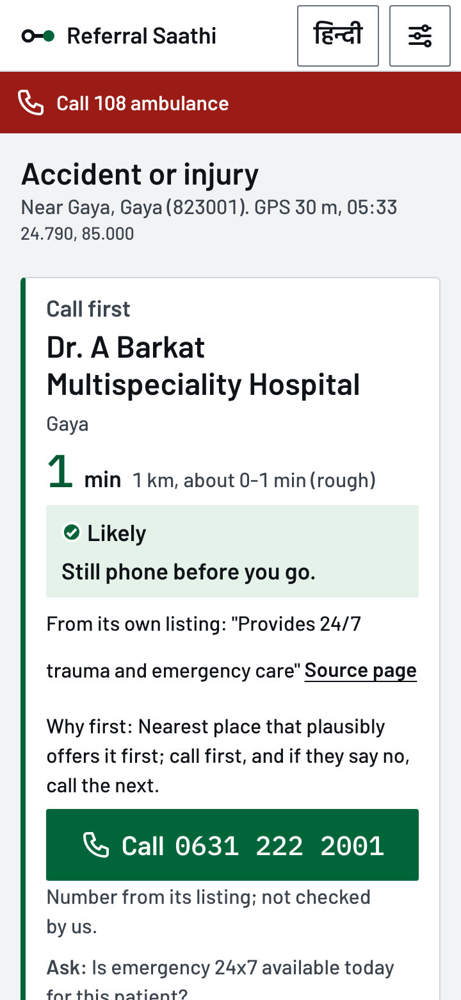

# Bharosa

A health worker in rural India types a service (dialysis, emergency caesarean, accident care) and gets whom to call
first, two backups and the one question to ask on the phone, each with the facility's own words as evidence and
how sure we are, in plain language. Behind each answer is a calibrated statistical model over an audited, repaired facility list and eight added public
sources, and the app keeps working offline on a cheap phone.

**Not the nearest, and not an unreachable "best".** Sending everyone to the closest listing ignores whether it
really offers the care; sending everyone to the best hospital ignores whether the patient can get there in time.
Bharosa weighs evidence, travel time and the care's time window, and when the right hospital is too far it
plans a stop to stabilise first. For example, after a road accident in Gaya, Bihar (24.79, 85.0), going straight to
AIIMS Patna takes about 92 minutes and misses the 60-minute window. So the app says: call Dr. A Barkat
Multispeciality Hospital, half a kilometre away and rated Likely ("Provides 24/7 trauma and emergency care"), for
first care, then go on to AIIMS Patna. A simulated referral world showed that in an emergency the nearest plausible
place first, with a call ahead, gets more patients to care in time than sending them farther for better evidence,
and the app stays within 1 to 2 points of the nearest listing plus a call ahead (simulated, not a field result).
*These numbers come from the route planner on model v2, as printed in section 7 of
[`submission/bharosa.ipynb`](submission/bharosa.ipynb) (trauma, at that point; the route's own
sentence is "Going straight to All India Institute of Medical Sciences Patna takes 92 min and misses the 60-minute
window; stopping first at Dr. A Barkat Multispeciality Hospital gives first care in about 1 min.").*



It is for ASHAs and other front-line health workers deciding where to send a patient, and for district planners
asking where the evidence of care is thin.

The submission is three things:

- **Video demo:** the app on a phone, start to finish.
- **This repository**, with the code for every step from audit to app.
- **The notebook**, with all our code and its outputs:
  [`submission/bharosa.ipynb`](submission/bharosa.ipynb). It is readable on GitHub as is, and runs
  on Databricks Free Edition ([`submission/README.md`](submission/README.md)).

The app itself runs on Databricks Apps in the team workspace, as shown in the video. Its "How this works" page
tells the same story as the notebook, in plain words. When online, it shows the options on an OpenStreetMap street
map with a Google Maps directions link for each (offline it keeps a simple drawn map). It is in English and Hindi,
plus machine-translated text in eight more languages: Tamil, Telugu,
Kannada, Malayalam, Bengali, Marathi, Gujarati and Urdu.

## What runs on Databricks

- **The App** (Databricks Apps, deployed by `tools/deploy/deploy.sh`). Typed requests the
  offline lexicon cannot place go to Llama 3.3 70B (`databricks-meta-llama-3-3-70b-instruct`), which also
  translates quotes. A photo of a referral note is read by Llama 4 Maverick (`databricks-llama-4-maverick`). Both
  are called through model serving, and a model's answer is kept only when its deciding phrase appears word for
  word in the input (`app/inputs/understand.py`). Speech goes through faster-whisper small on the App's own CPU:
  2.1 to 3.0 s per clip, 3 of 3 test clips parsed to the right service (`submission/measured_on_databricks.json`).
- **Unity Catalog:** one schema, 62 tables, including the model v2 scores
  (`facility_service_scores_v2`, 358,092 rows). The six v1 prototype tables are kept and commented SUPERSEDED.
  Which tables rebuild from this repo and which need unpublished inputs: `databricks/README.md`.
- **AI/BI dashboard** for district planners: five pages for district planners, built and tested by
  `databricks/dashboard/build_dashboard.py` (`databricks/dashboard/DASHBOARD.md`).
- **Genie agent** for planners: the planners' questions in plain English over the same tables, with
  instructions, 13 example queries and a 12-question benchmark. Native benchmark, 12 questions: 9 of 12, then
  10 of 12 on the live space (two runs,
  [`databricks/genie/benchmark_results.json`](databricks/genie/benchmark_results.json)); two of the 12 share an
  example's SQL shape (`databricks/genie/GENIE.md`). It answers the brief's "Where can a patient get dialysis near Jaipur?" with claim ids.
- **Notebooks** on serverless: `submission/bharosa.ipynb`, `submission/02_simulation.ipynb` and
  `submission/00_rebuild_derived.ipynb`. All three ran on Databricks serverless on 2026-11-22: run ids 796897435272535,
  418325743233710 and 245706239328385 ([release runs](submission/README.md#release-runs-2026-11-22-ran-on-databricks-serverless)).
- **A GPU run:** the evidence reader's last two backbones trained on a serverless A10G (Databricks AI Runtime),
  about 7 minutes each; the transparent rules matched or beat them (`model/reader/README.md`).

## Data we brought in

One row per outside source, read from [`validation/out/source_impact.csv`](validation/out/source_impact.csv)
(`validation/source_impact.py`, a counterfactual on the frozen v2 points, never a refit). Pairs are facility-service
pairs over the app's seven services. "Likely lost" counts Likely pairs that would leave Likely without the source,
through the service score or through the existence and location gates. "First answer changes" counts searches, over
300 seeded PIN centres per service, whose first option changes without it.

| Source | What it testifies | Pairs it fires on (Likely) | Likely lost: score, gates | First answer changes without it |
|---|---|---|---|---|
| NABH accreditation list | the hospital holds NABH accreditation | 2,206 (519) | 0, 17 | C-section 25 of 284; trauma 15 of 299; dialysis 48 of 297; cardiac surgery 55 of 297 |
| NMC medical colleges | it is a recognised medical college | 330 (79) | 0, 0 | C-section 8 of 284; NICU 12 of 291; trauma 4 of 299; dialysis 3 of 297; MRI 17 of 297; cardiac surgery 11 of 297 |
| e-RaktKosh blood centres | it runs a blood centre (needed for C-section, trauma, burns and cardiac surgery) | 1,460 (244) | 0, 0 | C-section 2 of 284; trauma 3 of 299; burns 5 of 274; cardiac surgery 23 of 297 |
| NHSRC LaQshya certification | its labour room or maternity theatre is LaQshya certified | 49 (3) | 0, 0 | C-section 2 of 284 |
| MoHFW trauma care facilities | it is a listed trauma care facility | 20 (5) | 0, 0 | trauma 4 of 299 |
| PMNDP dialysis lists | it is a listed dialysis centre | 1 (0) | 0, 0 | none |
| OpenStreetMap (HOT export) | a mapped health facility at that place | 124 (27) | 0, 4 | C-section 1 of 284; dialysis 5 of 297; MRI 9 of 297; cardiac surgery 2 of 297 |
| IPHS 2022 public standard | what a public facility of its level is meant to offer | 1,035 (126) | 0, 0 | C-section 3 of 284; NICU 1 of 291; trauma 2 of 299; dialysis 1 of 297; MRI 8 of 297; cardiac surgery 2 of 297 |
| all lists and OSM (X and O families) | all of the above except IPHS | 3,798 (781) | 0, 26 | C-section 36 of 284; NICU 12 of 291; trauma 23 of 299; burns 5 of 274; dialysis 56 of 297; MRI 26 of 297; cardiac surgery 77 of 297 |

The rule for every outside source: it is a cited witness on the Why page, never the ranking.

## How it works

```
provided facility table (Databricks Marketplace, 9,959 usable records)
  -> audit/        what is wrong: merged records, misplaced map points, copied sentences, shared phones
  -> cleaning/     fix what can be fixed, flag the rest; split every listing into sentences with ids
  -> derived/v1/   cleaned tables + a score with an interval for every data point (pipelines/source_scoring)
  -> kb/           taxonomy of services, care pathways, website crawl and open-data witnesses
  -> model/        the v2 model (model/v2): one score per facility and service, with its ledger of reasons
  -> derived/v2/   the frozen model's scores, witnesses and model card, which the app reads
  -> app/          FastAPI + one plain HTML page: whom to call, WHY (quotes) and HOW (points), offline packs
     planner/      multi-stop routes for time-critical cases (stabilise first, then definitive care)
     geo/          travel-time estimates, with hill-road factors by state
     sim/          the simulated referral world that chose the emergency order
  -> databricks/   Unity Catalog loader, AI/BI dashboard, Genie agent, read-only verification
```

At request time the app needs only the Python standard library plus FastAPI. Its data exports are built from
`derived/v1` and `derived/v2` in a few seconds.

## Reproduce

**On Databricks Free Edition:**
1. Install the Marketplace listing.
2. Add this repository as a Git folder.
3. Open `submission/bharosa.ipynb`, attach serverless compute, and Run all.
   - If your catalog has a different name, set `CATALOG` in its first code cell.
   - Details are in `submission/README.md`.

**Locally** (Python 3.11+, a venv with pandas, pyarrow, fastapi, uvicorn and pytest):

```
make app-data     # planner export, facts, offline packs, "How this works", stories, website check (derived/v1, v2)
make test         # app, planner and travel tests
make serve        # http://127.0.0.1:8000
make notebook     # re-run the submission notebook and save it with outputs
make help         # everything else: a11y check, data audit, public copy, deploy (lead only)
```

`make derived` rebuilds `derived/v1` itself. It needs the raw dataset under `data/raw/` (not in git) and the
upstream cleaning steps; see `derived/v1/README.md`.

## Map of the repository

| Folder | What is in it |
| --- | --- |
| `app/` | The Databricks App: API, page, service worker, offline packs, faithfulness and accessibility tests |
| `planner/`, `geo/` | Multi-stop referral planner; travel-time estimates |
| `audit/` | The data audit: each finding with its hand check (`REPORT.md` summarises it) |
| `cleaning/` | Location and identity cleaning; sentence attribution and service grades |
| `pipelines/` | Builds `derived/v1` (source reliability and data-point scores) |
| `derived/v1/` | The cleaned tables every other part reads |
| `derived/v2/` | The frozen model's outputs: scores, witnesses, model card |
| `sim/` | The simulated referral world behind the emergency order |
| `databricks/` | Unity Catalog loader, AI/BI dashboard, Genie agent and their verification |
| `kb/` | Service taxonomy, care pathways, website crawl, open-data matches |
| `external/` | Fetch and join code for 14 public lists, with licence notes |
| `model/` | Model spec, prototypes, gold labels, the statistical review |
| `app_design/`, `design/`, `research/` | Product spec, feasibility probes, concept notes, dataset research |
| `submission/` | The notebook and its builder |
| `demo/` | Storyboard, narration script and the Playwright capture for the video |
| `tools/` | Deploy script, data audit, public-copy script |

## The statistical model

Bharosa scores every facility-service pair (358,092 of them) with a **calibrated scorecard**, the same family of
statistical model as clinical risk scores. It reads **witnesses**: named pieces of evidence about one facility and
one service.

**1. Witness points.** Each witness $k$ contributes $w_k\,x_k(f,s)$ points for facility $f$ and service $s$. A
witness that its source cannot observe (a public hospital with no website, a facility outside a list's coverage)
has $x_k = 0$, so missing evidence never counts against a facility.

| Witness family | What it reads | Why it is in the model |
|---|---|---|
| Own text | the facility's own sentences about the service, more points for more and stronger lines | the primary claim, weighted by how specifically the listing states it |
| Prerequisites | the listing names what the care needs (operating theatre, ICU, blood bank, cath lab) | care without its prerequisites is not credible |
| Dedicated unit | a named unit for the service | a unit implies staff and equipment |
| Website | the facility's own website states the service (our crawl) | independent of the scraped record, so it survives merged-record contamination |
| Public lists | NABH, NMC, e-RaktKosh, LaQshya, MoHFW trauma, dialysis lists | official verification from outside the dataset |
| OpenStreetMap, IPHS | mapped tags; what a public facility of its level is meant to offer | coverage for public hospitals that do not advertise online |
| Facility type and level | clinic, sub-divisional or district hospital | what a facility of that kind can plausibly do |
| Contamination | the evidence comes from a merged or low-trust record | 25% of records carry another hospital's text |
| Negation, scope | "not offered", or only a narrower mention | keeps a denial or a partial sentence from counting as the service |

**2. Score and calibration.** The points add up to a score, and a fitted logistic calibration (Platt scaling)
turns the score into a probability:

$$S(f,s) = \sum_k w_k\,x_k(f,s), \qquad P_S(f,s) = \frac{1}{1 + e^{-(a\,S(f,s) + c)}}, \quad a = 0.502,\ c = 1.498$$

$a$ and $c$ are fitted on the 221 decided development pairs (`derived/v2/model_card.json`).

**3. Three heads, one band.** Location ($P_L$: is the map point right) and existence ($P_E$: is the facility
real and operating) are scored by their own heads. A pair is rated **Likely** only when all three agree:

$$\text{Likely} \iff p \ge 0.369,\quad P_L \ge 0.7,\quad P_E \ge 0.7$$

The Likely threshold is the lowest score whose out-of-fold precision is at least 0.85; 102 of 120 development
Likely pairs confirmed. Unlikely is $p \le 0.2$.

**4. Explanations by construction.** The app shows $100\,p$ as the evidence score out of 100, and the Why page
lists every term $w_k x_k$ with its quote or list entry, so the score is a sum the user can audit row by row.

**5. Selection and validation.** Candidates ranged from the expert scorecard to fully fitted models and three
transformer readers. The rule, fixed before fitting, ships the least-fitted candidate unless a more-fitted one
lowers grouped five-fold out-of-fold log loss by one paired cluster standard error. The selected model was frozen,
its hash published, and only then tested on a sealed set (Results below).

## Results

- **Sealed test** ([`model/gold/v3/test_eval/results.json`](model/gold/v3/test_eval/results.json)), opened once
  after the model was frozen and its hash published: **25 of the 28 Likely pairs with a verdict were confirmed,
  0.893 [0.728, 0.963]**. AUROC **0.819** [0.686, 0.924] on the 60 decided pairs; log loss 0.406 against 0.523 for
  the base rate; Brier 0.132; ECE 0.068. Where a facility's own website states the service, **21 of 21** confirmed.
- **The statistical model** ([`derived/v2/model_card.json`](derived/v2/model_card.json)): A_platt, a calibrated
  scorecard, chosen by a selection rule fixed before fitting (ship the least-fitted candidate unless a more-fitted
  one lowers grouped five-fold out-of-fold log loss by one paired cluster SE). Out of fold on 221 pairs: AUROC
  **0.800** [0.720, 0.867], log loss **0.427** against 0.557 for the base rate, **ECE 0.044**.
- **Transparent beats deep learning:** three transformer sentence readers (MiniLM, bge-small, multilingual-e5; two
  trained on a Databricks A10G GPU) matched or lost to the transparent rules, so every answer stays explainable.
- **The data audit** (`REPORT.md`): 2,489 of 9,959 records (25%) carry a sentence naming another facility; the
  1,232 written as if about the record itself are quarantined as evidence. 1,171 ranking points moved > 25 km.
- **Unlikely is reliable:** a low score (p <= 0.2) was right on 9 of 9 labelled pairs.
- **Label quality:** Cohen's kappa 0.834 (development) and 0.624 (test), with no test pair where one labeller
  confirmed and the other contradicted.
- **Outside data changes answers** ([`validation/out/source_impact.csv`](validation/out/source_impact.csv)):
  removing every list and OpenStreetMap row changes the first answer for 56 of 297 dialysis and 77 of 297 cardiac
  surgery searches (19% and 26%, over 300 seeded PIN centres).
- **Faithfulness by construction:** every number and quote the app shows is checked against its stored row by
  `app/tests/test_faithfulness.py` before release.

## Scope

- Labels come from public web checks; call-outcome reports from health workers extend them in the field.
- Travel times are estimates shown as ranges, and every answer ends with a call to confirm before travelling.

## Data sources and licences

- **Facility records:** the Virtue Foundation dataset from the Databricks Marketplace, used under its consumer
  terms.
- **PIN code boundaries and the NFHS district tables:** Government Open Data Licence (GODL) and ODC-BY.
  LGD and NHSRC lists: reproduced with credit, as their policies allow.
- **NABH, NMC and the MoHFW trauma list:** used only as per-facility facts with a citation. The lists themselves
  are not in this repository.
- **OpenStreetMap:** (c) OpenStreetMap contributors, ODbL. WorldPop and MAP travel time: CC BY.
- **e-RaktKosh blood centres:** shown only as single-centre facts with a link.
- The full table, with each source's terms and hand-check results, is in `research/DATASETS.md`.
- What this repository holds, file by file, is in `DATA_AUDIT.md`.

## Licence

The code is under the MIT licence (`LICENSE`). The data in this repository is not: each dataset stays under its own
terms, listed above and in `research/DATASETS.md`.

Not clinical advice. In an emergency call 108.
