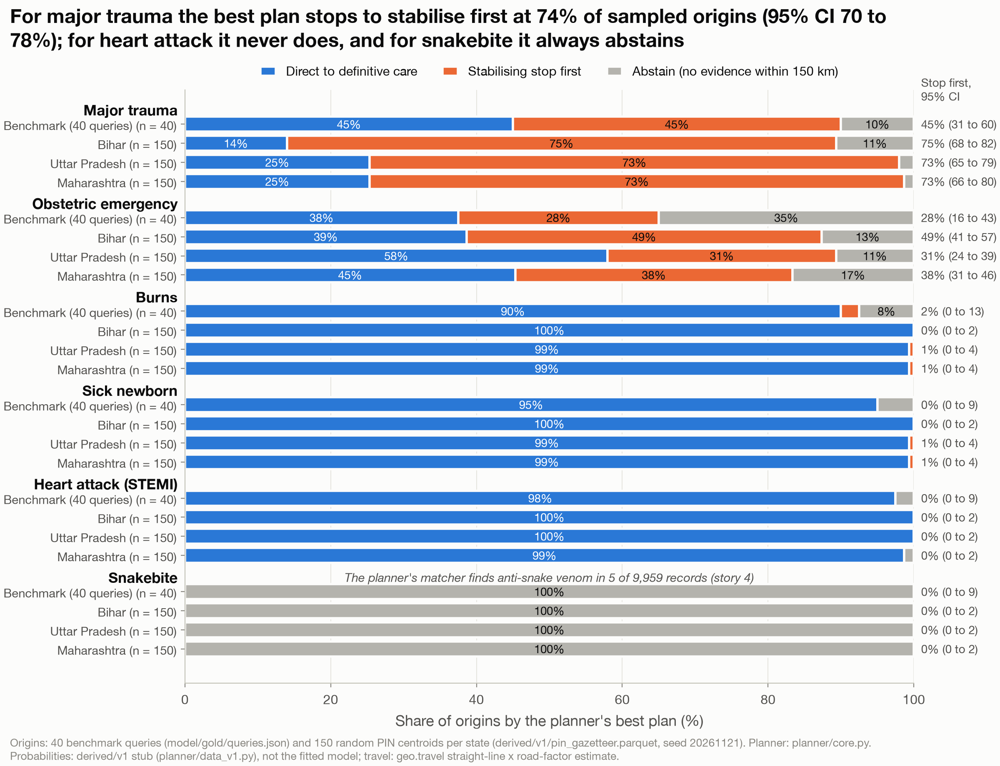
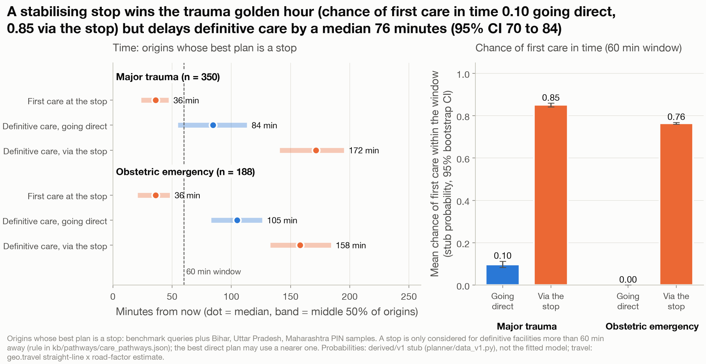
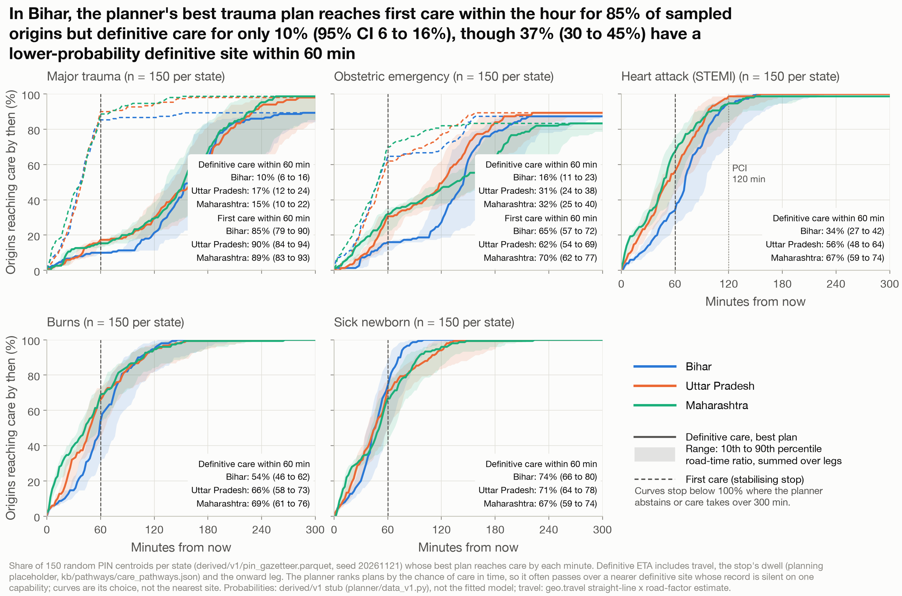
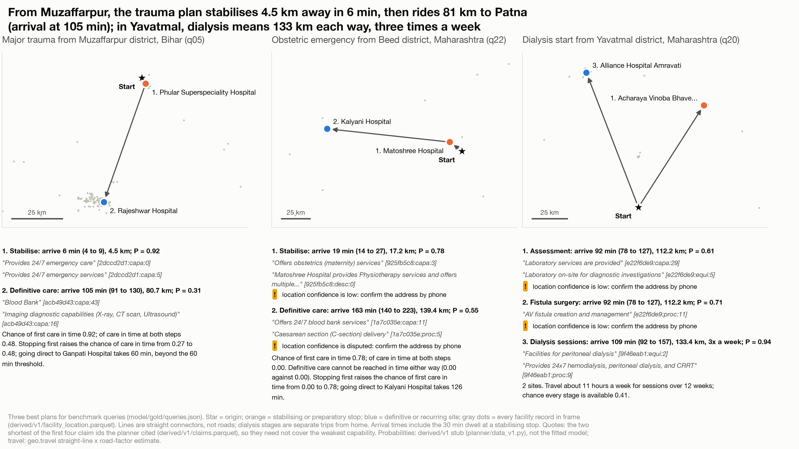
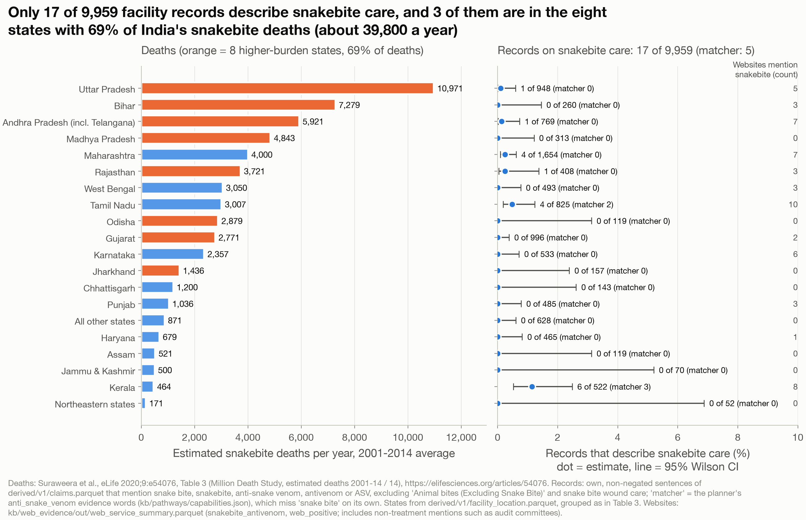
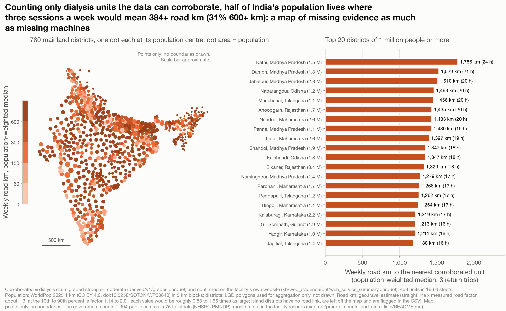
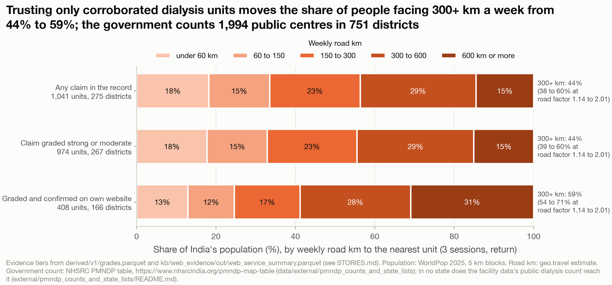
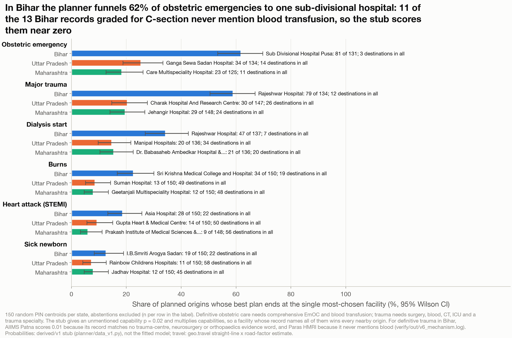

# The golden hour: referral journeys

Six data stories about what happens after "where should this patient go?": how often the best plan is a
stabilising stop, how long definitive care takes, what real itineraries look like, which service the data cannot
see, how far dialysis patients would travel, and how the planner funnels whole states to one hospital.

Every number below comes from the scripts in `scripts/`, run on 2026-11-21. Reproduce all of it with
`.venv-viz/bin/python viz/journeys/notebook.py` (about 45 s; Databricks notebook format, runs locally as a script).

Read this first: every probability here is the derived/v1 stub in `planner/data_v1.py`, not a fitted model. A
capability mapped to a graded service takes that facility's `service_claim` score from
`derived/v1/data_point_scores.parquet`; other capabilities take 0.715 for one matching sentence and 0.783 for two or
more; a capability the record never mentions takes 0.02. That last assumption drives several of the stories below.
When the fitted model replaces `capability_p`, rerun the notebook. For context, the published model results are
weak: test AUROC 0.776 against 0.789 for the prior alone, ECE 0.197, and end-to-end confirmed top-1 in 5 of 40
benchmark queries (`model/review/stats/results.json`, `model/MODEL_SPEC.md`). Nothing here touches the gold TEST
labels.

## Inputs and sample

- Planner: `planner/core.py` with `planner/data_v1.py` inputs, 9,959 facilities, pathways from
  `kb/pathways/care_pathways.json`. Travel: `geo/travel.py` estimate (straight line x measured road factor at the
  measured free-flow speed, hill constants for hill states, no network calls; `TRAVEL_CACHE=off`).
- Origins (`scripts/run_plans.py`): the 40 benchmark points in `model/gold/queries.json`, each run against all 7
  pathways (as in `planner/README.md`; our abstain counts match its table), plus 150 PIN centroids per state drawn at
  random (seed 20261121) from the 839 Bihar, 1,544 Uttar Pradesh and 1,600 Maharashtra rows of
  `derived/v1/pin_gazetteer.parquet` with `src == "pin_median"` (centroid of the PIN's own post offices). 490 origins x 7 pathways = 3,430 plans, saved in
  `data/plans_raw.json.gz` (full results) and `data/plans_best.csv` (one row per origin and pathway).
- A PIN sample is not a population sample. PIN areas are smaller where people are dense, so it leans towards
  people, but it is unweighted. Story 5 is population-weighted (WorldPop).

## 1. A stop to stabilise is the usual trauma plan, and it trades definitive time for the golden hour

Headline: for major trauma the best plan stops to stabilise first at 74% of sampled origins (332 of 450, 95% CI
70 to 78%); for heart attack it never does, and for snakebite it always abstains.

Second chart: a stabilising stop raises the mean chance of first care within 60 minutes from 0.10 (going direct)
to 0.85 (via the stop) for the 350 trauma origins whose best plan is a stop, but definitive care arrives a
median 76 minutes later (95% CI 70 to 84): 172 min via the stop against 84 min going direct. For obstetric
emergencies (188 origins) first care rises from 0.00 to 0.76 and definitive care comes 48 min later; neither plan
meets the 60 minute comprehensive EmOC window (chance 0.00 both ways).

| Pathway | One stop, Bihar | One stop, Uttar Pradesh | One stop, Maharashtra | One stop, benchmark |
|---|---|---|---|---|
| Major trauma | 75% | 73% | 73% | 45% |
| Obstetric emergency | 49% | 31% | 38% | 28% |
| Burns, sick newborn | 0 to 1% | 1% | 1% | 0 to 3% |
| STEMI | 0% | 0% | 0% | 0% |
| Snakebite | abstain 100% | abstain 100% | abstain 100% | abstain 100% |

Why it matters. Health workers: the card should show both clocks, "first care in 36 min" and "definitive care in
172 min", because the stop buys the first at the price of the second. Coordinators: a stop plan commits two
facilities, so the call-ahead list has two numbers. Model: the stop only exists when the definitive site is more
than 60 min away (rule `stop_only_if_definitive_far`), so the jump from 0.10 to 0.85 is partly built in; the
finding is the size of the delay, not that the stop helps.

Method: `scripts/s1_plan_mix.py`. Shares carry 95% Wilson intervals (`data/s1_plan_mix.csv`); medians and means in
the trade-off carry 95% percentile-bootstrap intervals over origins (2,000 resamples, `data/s1b_stop_tradeoff.csv`).

Caveats: stub probabilities; the 30 min dwell at the stop is a planning placeholder
(`kb/pathways/care_pathways.json`), and so is the 60 min stabilise window for trauma ("basis": "assumption"). The
best direct plan and the stop plan may use different definitive facilities, so "extra minutes" compares plans, not
routes to one place. STEMI never gets a stop in this sample. Breakdown (verification, `verify/out/v1b_stemi.log`): 19 of
487 planned STEMI origins have a PCI leg over the 120 min gate, so a stop was considered there, but only 48 of 9,959
records carry any thrombolysis evidence and no stop plan was generated (0 dropped below the margin). The chart's
right-hand column gives each stop share with its 95% Wilson interval.

## 2. Bihar: the planner's trauma plan gives first care in the hour for 85%, definitive care for 10%

Headline: in Bihar, the planner's best trauma plan reaches first care within 60 minutes for 85% of sampled origins
(79 to 90%) but definitive care for only 10% (6 to 16%), though 37% (56 of 150, 30 to 45%) have a lower-probability
definitive site within 60 minutes that the planner passes over.

Definitive care within 60 minutes, 150 origins per state (95% Wilson CI):

| Pathway | Bihar | Uttar Pradesh | Maharashtra |
|---|---|---|---|
| Major trauma | 10% (6 to 16) | 17% (12 to 24) | 15% (10 to 22) |
| Obstetric emergency | 16% (11 to 23) | 31% (24 to 38) | 32% (25 to 40) |
| STEMI (PCI) | 34% (27 to 42) | 56% (48 to 64) | 67% (59 to 74) |
| Burns | 54% (46 to 62) | 66% (58 to 73) | 69% (61 to 76) |
| Sick newborn | 74% (66 to 80) | 71% (64 to 78) | 67% (59 to 74) |

Bihar's point estimate is the lowest for four of five pathways (for trauma the three intervals overlap, so that
ranking is not settled) and the highest for sick newborns; 16 of its 150 trauma origins (11%) get no plan at all. Median definitive ETA for trauma is 153 min in Bihar and Maharashtra, 161 min in Uttar Pradesh.

Why it matters. The 10% is the planner's choice, not the map's: it ranks plans by the stub chance of care in
time, so it passes over a nearer definitive site whose record is silent on one capability (story 6). The best direct
trauma plan reaches some definitive site within 60 minutes for 37% of Bihar origins (Uttar Pradesh 45%, Maharashtra
39%, `verify/out/v1_check_plans.log`). Planners: part of the gap between the dashed (first care) and solid
(definitive) curves is capacity and part is missing evidence; this chart cannot separate them. For the demo: "85%
get first care within the hour; the planner then sends most of them to a surgical centre more than an hour away".

Method: `scripts/s2_time_to_care.py`. Each curve is the share of the state's 150 origins whose best plan reaches
the definitive facility by each minute; abstaining origins stay in the denominator. The shaded band uses the
plan's `eta_low` and `eta_high`: geo.travel's measured 10th and 90th percentile ratio of OSRM time to the estimate
(78 to 79% of held-out road routes fall inside), summed over legs. Data: `data/s2_ecdf.csv`,
`data/s2_within_window.csv`.

Caveats: free-flow road time with no traffic or ambulance dispatch delay, so all curves are optimistic. The band is
travel uncertainty only; it does not include the uncertainty in whether the facility can deliver (stub p). The
ETA is for the planner's best plan, which maximises the chance of care in time, not the nearest facility.

## 3. Three real plans, drawn with their evidence

Headline: from Muzaffarpur the trauma plan stabilises 4.5 km away in 6 min, then rides 81 km to Patna, arriving
at 105 min (range 91 to 130, including the 30 min dwell at the stop); in Yavatmal, dialysis means 133 km each way,
three times a week.

- Major trauma, Muzaffarpur district, Bihar (q05): stabilise at Phular Superspeciality Hospital (P 0.92, "Provides
  24/7 emergency care" [2dccd2d1:capa:0]), then Rajeshwar Hospital, Patna (P 0.31, "Blood Bank" [acb49d43:capa:43]).
  Chance of first care in time 0.92; of care in time at both steps 0.48, against 0.27 going direct to Ganpati
  Hospital (60 min).
- Obstetric emergency, Beed district, Maharashtra (q22): stabilise at Matoshree Hospital (19 min, P 0.78), then
  Kalyani Hospital, Murud (163 min, range 140 to 223, P 0.55, "Caesarean section (C-section) delivery"
  [1a7c035e:proc:5]). Both locations are flagged (low, disputed): the card says "confirm the address by phone".
  Definitive care cannot be reached within 60 minutes either way.
- Dialysis start, Yavatmal district, Maharashtra (q20): assessment and fistula surgery at Acharaya Vinoba Bhave Rural
  Hospital, Sawangi (spelling as in the record) (112 km, low location confidence), sessions at Alliance Hospital Amravati (133 km, 109 min each
  way, "Provides 24x7 hemodialysis, peritoneal dialysis, and CRRT" [9f46eab1:proc:9]): about 11 hours of travel a
  week.

Why it matters. This is the product's answer format: every stop has a time with a range, a probability, a quoted
sentence with its claim id, and any location warning. The Beed plan shows uncertainty being communicated rather
than hidden.

Method: `scripts/s3_itineraries.py`, best plans from `data/plans_raw.json.gz`; quotes are the two shortest of the
first four claim ids the planner cited, from `derived/v1/claims.parquet`; gray dots are every facility record in
frame. Data: `data/s3_itineraries.csv`. Every quoted claim id was checked against `derived/v1/claims.parquet` and
belongs to the facility it is shown under (`verify/out/v3_quotes.log`). Because quotes are picked by length, the
dialysis assessment stop shows two laboratory sentences rather than its nephrology evidence; the app should quote the
weakest capability instead.

Caveats: straight connectors, not roads. Quotes are what the record says, not verified facts (5.4% of claims were
found on their cited page, `derived/v1/evaluation.json`). The evidence for Matoshree as a basic EmOC stop is one
sentence, "Offers obstetrics (maternity) services".

## 4. The invisible service: snakebite

Headline: only 17 of 9,959 facility records describe snakebite care, and 3 of them are in the eight states with
69% of India's snakebite deaths (about 39,800 a year). The planner's matcher finds just 5 of the 17, all in Kerala
and Tamil Nadu, so it abstains everywhere.

Verification note: the first version of this story said the eight states had none. That was an artefact of the
planner's `anti_snake_venom` evidence words, which do not include "snake bite" on its own. Reading every claim that
mentions a snake (`verify/out/v4b_loose.log`) finds 17 records that describe snakebite care: Kerala 6, Maharashtra 4,
Tamil Nadu 4, and one each in Uttar Pradesh (Sahara Hospital, "animal bites (snake bite, ...)"), Rajasthan
(Gyan Shanti Hospital, Kota) and Telangana (Harsha Hospitals). Bihar still has none (0 of 260).

India had about 1.2 million snakebite deaths from 2000 to 2019, an average of 58,000 a year, about 70% in eight
higher-burden states, 94% rural and half in June to September (Suraweera et al., "Trends in snakebite deaths in
India from 2000 to 2019 in a nationally representative mortality study", eLife 2020;9:e54076,
https://elifesciences.org/articles/54076). By that study's state estimates (Table 3, 2001-2014), Uttar Pradesh
loses about 10,970 people a year and Bihar about 7,280. In the facility data, 1 of 948 Uttar Pradesh records and 0
of 260 Bihar records describe snakebite care (95% upper bounds 0.6% and 1.5%). Kerala, with the lowest death rate
in the table (0.5 per 100,000 in 2010-14), holds 6 of the 17. Even with all 17 records, a mention would lie within
the planner's 150 km radius for 0 of 150 Bihar origins (0 to 2%), 38 of 150 in Uttar Pradesh (25%, 19 to 33%) and
103 of 150 in Maharashtra (69%, 61 to 76%) (`verify/out/v4c_coverage.log`). Facility websites say more: 58 records'
own sites mention snakebite (including 5 in Uttar Pradesh), though some are audit committees, not treatment.

Why it matters. Health workers: for snakebite the guideline answer is "nearest facility now, confirm ASV by phone"
(`kb/pathways/care_pathways.json`, rule `nearest_facility_now`), and IPHS 2022 lists antivenom at PHC, CHC, SDH and
DH. The planner abstains for all 490 origins because it requires a mention and its lexicon misses "snake bite".
Model: add "snake bite" to the `anti_snake_venom` evidence words; even then no Bihar origin has a mention within
150 km. Absence of text is not absence of service, so snakebite needs a facility-type prior (public PHC or above)
rather than text evidence.

Method: `scripts/s4_snakebite.py`. Mentions: own, non-negated sentences of `derived/v1/claims.parquet` that match
snake bite, snakebite, anti-snake venom, antivenom, snake envenomation or ASV, excluding the "Animal bites
(Excluding Snake Bite)" line and snake bite wound care; the chart also gives the planner's own matcher count
(evidence words for `anti_snake_venom` in `kb/pathways/capabilities.json`). Table 3 was re-read from the paper
(PMC7340498) during verification and every row matches. States from
`derived/v1/facility_location.parquet`, grouped as in the study's Table 3 (Andhra Pradesh includes Telangana; seven
north-eastern states pooled). Deaths per year = estimated deaths 2001-2014 / 14, transcribed in
`data/sources/mds_snakebite_table3.csv` (group totals check against the paper). Data: `data/s4_snakebite.csv`.

Caveats: the death estimates are 2001-2014 and carry no intervals in Table 3; the paper's text gives 58,000 a year
for 2000-2019. The 17 is a reading of sentence text: one is historical ("known for anti-venom treatment ... in the
1990s", CSI Mission Hospital) and none is a verified stock of antivenom.

## 5. Dialysis: a map of missing evidence

Headline: counting only dialysis units the data can corroborate, half of India's population lives where three
sessions a week would mean 384 road km or more, and 31% where it would mean 600 km or more.

Three evidence tiers (`derived/v1/grades.parquet`, `kb/web_evidence/out/web_service_summary.parquet`):

| Tier | Units | Districts with one | People facing 300+ km a week | 600+ km a week |
|---|---|---|---|---|
| Any claim in the record | 1,041 | 275 | 44% | 15% |
| Graded strong or moderate | 974 | 267 | 44% | 15% |
| Graded and confirmed on own website | 408 | 166 | 59% | 31% |

With corroborated units only, 321 of 780 mainland districts (435 million people) have a population-weighted median
of 600 km a week or more; with any claim, 164 districts (191 million). The most burdened districts of a million
people or more are Katni (1,786 km, about 24 hours a week), Damoh and Jabalpur in Madhya Pradesh. The government
counts 1,994 public dialysis centres in 751 districts (NHSRC PMNDP table, https://www.nhsrcindia.org/pmndp-map-table),
and in no state does the facility data's public dialysis count reach it (`external/pmndp_counts_and_state_lists/README.md`:
Bihar 7 against 94, Uttar Pradesh 7 against 76). So Jabalpur does not lack dialysis; the data lacks Jabalpur's
dialysis.

Why it matters. Planners and the product: this is the cost of trust. Insisting on a second source raises the share
of people facing 300 km or more a week from 44% to 59%. The gap holds under a road-factor sensitivity (one factor
for every trip at the 10th and 90th percentile, 1.14 and 2.01): 38 to 60% for any claim against 54 to 71% for
corroborated units. The fix is data, not a stricter threshold: joining a
facility-level PMNDP list would shrink these numbers more than any model change. Health workers: the planner's
dialysis plans put the sessions site a median 100 km away in the Bihar sample (79 km in Uttar Pradesh, 97 km in
Maharashtra), which is 600 km of road a week.

Method: `scripts/s5_dialysis.py`. WorldPop 2025 1 km constrained population (CC BY 4.0, doi:10.5258/SOTON/WP00840)
summed to 5 x 5 km blocks (156,048 populated blocks, 1.457 billion people). Each block goes to an LGD district by
point-in-polygon (polygons used for aggregation only, never drawn). Nearest unit by great-circle distance
(BallTree), then `geo.travel.estimate` for road km and minutes. Weekly km = 3 sessions x 2 legs x road km. District
values are population-weighted medians. Data: `data/s5_district_dialysis.csv`, `data/s5_population_bands.csv`,
`data/s5_cells.parquet`.

Caveats: nearest by straight line, then a road factor, so it is an estimate; geo.travel's road factor ranges 1.14 to
2.01 (10th to 90th percentile) and its constants are measured only up to 150 km. The sensitivity above (rows "300+ at factor p10/p90" in `data/s5_population_bands.csv`) scales every trip by one
factor, a bracket rather than a model. Island districts (Andaman and Nicobar, Lakshadweep) have no road link; they
are flagged `road_estimate_valid = False`, left off the map, and their km figures are meaningless. Verification
recomputed the headline on 1 km pixels instead of 5 km blocks with independent code (`verify/v5_dialysis.py`):
weighted median 385 km; 300+ km 44%, 44%, 59%; 600+ km 15%, 15%, 31%; 319 mainland districts (435 million people)
at 600+ km; Katni 1,785 km. Website confirmation needs a website,
so the corroborated tier is biased against public hospitals. Facility locations with low or disputed confidence
were kept.

## 6. The funnel: one hospital absorbs a state

Headline: in Bihar the planner sends 62% of obstetric emergencies (81 of 131, 95% CI 53 to 70%) to one
sub-divisional hospital (SDH Pusa, Samastipur), and 59% of trauma (79 of 134) to Rajeshwar Hospital, Patna. Of the
13 Bihar records graded strong or moderate for C-section, 11 never mention blood transfusion, so the stub scores
their definitive obstetric stage 0.015 to 0.019 and only 2 clear the planner's 0.05 candidate floor
(`verify/out/v6_mechanism.log`).

All 131 planned Bihar obstetric emergencies end at just 3 facilities; Uttar Pradesh uses 14 and Maharashtra 11.
For STEMI, sick newborns and burns in Uttar Pradesh and Maharashtra the most-chosen facility takes 6 to 9% of
origins, and up to 58 facilities share the load.

Why it matters. Model and explainability: this is the clearest picture of how the stub behaves. The same rule
drops AIIMS Patna from definitive trauma care (0.01: its record matches no trauma-centre, neurosurgery or
orthopaedics evidence word) and Paras HMRI (0.01: no blood mention); only 7 of 260 Bihar records clear the floor. Definitive
obstetric care needs comprehensive EmOC and blood transfusion; a record that does not mention blood gets 0.02 for
it, so the product of capabilities collapses for every facility that is silent on one requirement, and the few
whose text names everything win every origin within reach. Planners: if a real referral system behaved like this,
one hospital would take the whole state's load. The fitted model must not punish silence this hard, and the app
should show "why this facility" (the weakest capability and its evidence) next to every recommendation.

Method: `scripts/s6_funnel.py`; abstaining origins excluded; 95% Wilson intervals. Data: `data/s6_funnel.csv`.

Caveats: stub probabilities. The district shown for some facilities in the cleaned table is wrong (for example
"Dr. Babasaheb Ambedkar Hospital & Research Center, Nagpur" carries district PUNE), so the chart labels names only.

## Not run

- Comparison of plans with real referral decisions, or clinician review of any plan.
- Live OSRM routing of the plans (all travel is the offline estimate).
- A road-network (OSRM) check of the story 5 distances; the sensitivity bracket was run instead.
- Unity Catalog mode of `notebook.py` (`JOURNEYS_SOURCE=uc`) was written but not run; local mode was run end to end.
- Population weighting of the PIN samples in stories 1, 2 and 6.

## Verification (2026-11-21)

Independent recomputation scripts and logs are in `verify/` (`verify/out/*.log`). An independent re-run of the
planner on re-drawn origins (`verify/v0_rerun_planner.py`) matched `data/plans_raw.json.gz` on all 3,430 runs (plan
type, definitive facility and ETA). Stories 1, 2, 3 and 6 were recomputed from the raw planner output without the
analyst's CSVs (`verify/v1_check_plans.py`), story 4 by reading every snake mention, and story 5 on 1 km pixels.
Changes: story 4 headline corrected (17 records describe snakebite care, 3 in the eight higher-burden states, not
0); story 2 headline reframed as the planner's choice, with the 37% passed-over figure; story 5 islands dropped
from the map and road-factor sensitivity added; story 1 stop-share intervals added and the STEMI breakdown run;
story 3 label collisions and arrival-time wording fixed; story 6 mechanism quantified.
