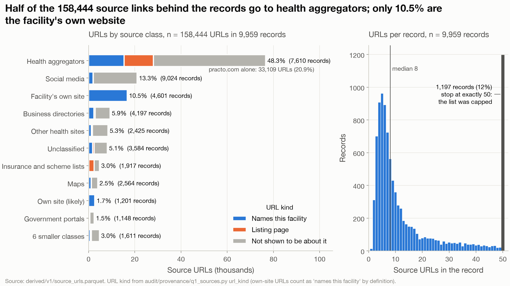
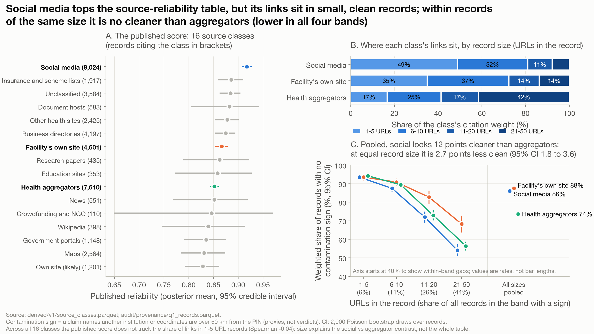
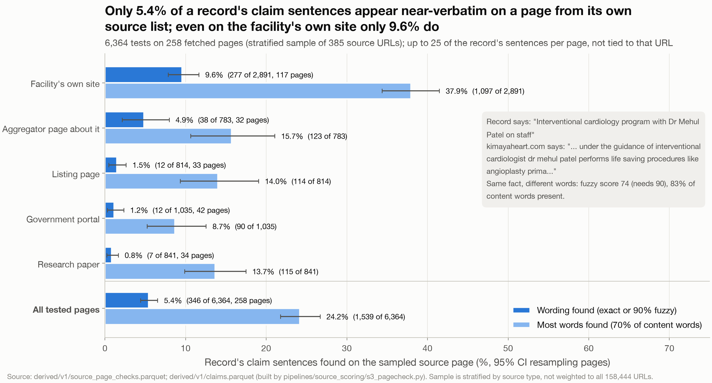
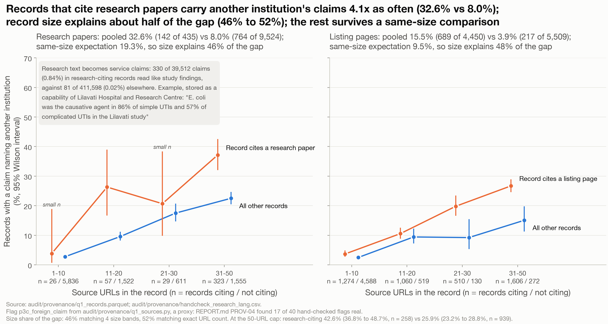
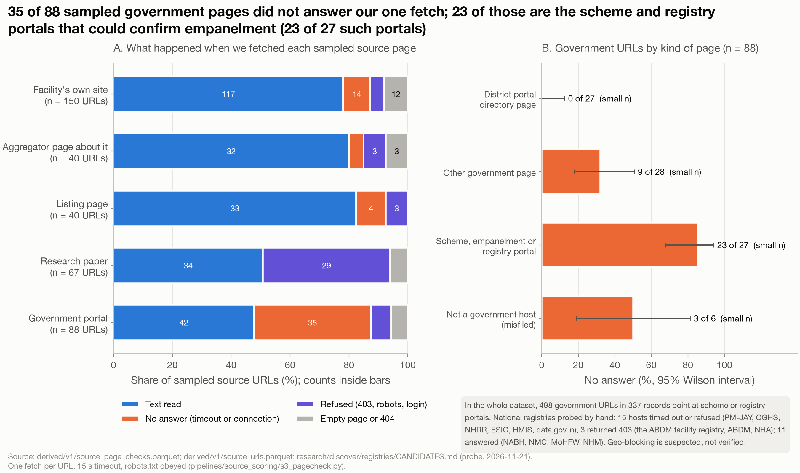
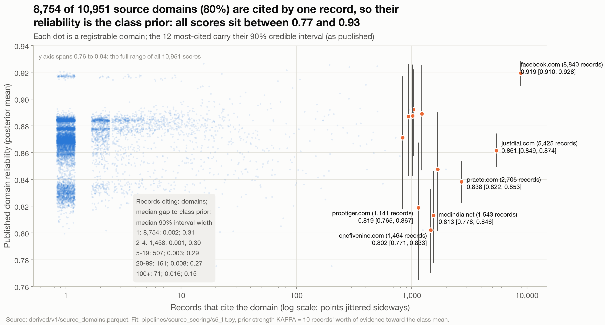

# Who said so? Six stories about the records' sources

Every record in the Virtue Foundation facility table carries a list of `source_urls`. These charts ask what
those links are, whether they back the claims, and what a source score can and cannot tell the Referral Saathi
app. All numbers below come from the scripts in this folder; each chart has a tidy CSV beside it and an alt-text
TXT. Rebuild everything with `.venv-viz/bin/python viz/sources/notebook.py` (about 6 s; run log in
`notebook_run.log`). `notebook.py` is generated from the story scripts by `make_notebook.py`; edit the scripts,
not the notebook.

Inputs (read only): `derived/v1/source_urls.parquet`, `source_classes.parquet`, `source_domains.parquet`,
`source_page_checks.parquet`, `claims.parquet`; `audit/provenance/q1_records.parquet`,
`audit/provenance/handcheck_research_lang.csv`; the registry probe list in
`research/discover/registries/CANDIDATES.md`. No gold label (dev or test) is read by any script here.

| # | Story | Chart | Use in |
|---|---|---|---|
| 1 | Half the links are aggregators; 10.5% are the facility's own site | `s1_composition.png` | demo, slides, how page |
| 2 | Social media "most reliable" is a record-size artefact | `s2_simpson.png` | slides, model card |
| 3 | 5.4% of a record's claim sentences appear near-verbatim on a page from its source list | `s3_paraphrase.png` | demo, slides, how page |
| 4 | Research papers carry other institutions' claims into records | `s4_vectors.png` | slides, how page |
| 5 | Government scheme and registry portals do not answer from our network | `s5_reachability.png` | slides, how page, model card |
| 6 | 80% of domains are seen once, so their score is the class prior | `s6_shrinkage.png` | model card, appendix |

## 1. Half of the 158,444 source links go to health aggregators; 10.5% are the facility's own website

- Health aggregators supply 76,578 URLs (48.3%), social media 21,010 (13.3%), the facility's own site 16,714
  (10.5%). One domain, practo.com, supplies 33,109 URLs (20.9% of all links).
- facebook.com appears in 8,840 of 9,959 records; social media in 9,024.
- Only 44,434 URLs (28.0%) name the facility in their path or are its own site; 96,670 (61.0%) are not shown to
  be about it. Listing pages: 17,340.
- Records carry a median of 8 URLs; 1,197 records (12%) stop at exactly 50, so the source list was capped.

Why it matters. A health worker who taps "source" will usually land on a Practo or Justdial page, not the
hospital. The app should cite the sentence and the page that contains it (story 3), not the URL list.
For the model, the URL list is search-hit metadata, not a citation list (REPORT.md PROV-01).

Method. `s1_composition.py`: counts over `source_urls.parquet` (one row per record x URL). Source class from
`audit/provenance/domains.py`, URL kind from `audit/provenance/q1_sources.py url_kind`. Classes under 1.5% of
URLs are folded into one bar.

Caveats. Own-site URLs count as "names this facility" by definition. Class labels come from a domain
classifier; some domains are misfiled (story 5 finds 6 of 88 sampled "government" URLs on private hosts).

## 2. Social media tops the reliability table, but within records of the same size it is no cleaner than aggregators

- Published class reliability (panel A): social media 0.917 (95% credible interval 0.907 to 0.927), the
  highest of 16 classes; facility websites 0.867; health aggregators 0.852.
- Where the links sit (panel B): 49% of social media's citation weight is in records with 1 to 5 URLs, against
  35% for facility websites and 17% for aggregators. 42% of aggregator weight is in records with 21 to 50 URLs.
- Small records are cleaner: 6.5% of records with 1 to 5 URLs show a contamination sign, 43.9% of records with
  21 to 50.
- Pooled over all sizes, social-weighted records are 86.1% clean (95% CI 85.2 to 86.9) against 73.7% (72.5 to
  74.8) for aggregators, a 12-point gap. Within each size band social is lower: 93.5 vs 94.2 (1 to 5 URLs),
  87.5 vs 89.4 (6 to 10), 71.9 vs 72.9 (11 to 20), 54.0 vs 56.4 (21 to 50). The intervals overlap in every
  band, so the honest reading is "no cleaner", not "worse". This is Simpson's paradox: the pooled ordering
  reverses within strata.

Why it matters. For the model: a source-class score built from record-level outcomes measures how big the
records citing that source are as much as the source itself. Do not show "Facebook = most reliable" to users,
and do not let a source score override evidence in the text. Matched on exact record size (direct standardisation
over URL counts 1 to 50), social-weighted records are 77.4% clean against 80.1% for aggregators, a gap of -2.7 points
(95% CI -3.6 to -1.8, record bootstrap): social is less clean, not just no cleaner. But across all 16 classes the
published score does not track how much of a class's weight sits in 1 to 5 URL records (Spearman -0.04), so size
explains the social vs aggregator contrast, not the ordering of the whole table. For planners: more links per record means more
merged and contaminated content, not more evidence (REPORT.md PROV-02, F5).

Method. `s2_simpson.py`. Panel A recomputes the published pooled Beta(1 + effective true, 1 + effective false)
from `source_classes.parquet` (asserted equal to the published mean) and draws a 95% interval from it. Panels B
and C use `q1_records.parquet`: a record has a contamination sign when a claim sentence names another
institution (`p3c_foreign_claim`) or its coordinates sit more than 50 km from its PIN centroid
(`p4_coord_far_from_pin`). Each record counts toward a class in proportion to that class's share of its URLs,
which mirrors the per-record normalisation of the reliability fit without its hand-set kind and class
multipliers. Intervals: 2,000 Poisson bootstrap draws over records.

Caveats. Panel A comes from the fitted score (evidence rules, gold dev verdicts, hand-set multipliers); panels B
and C use audit proxies. They are different outcomes, so the chart shows the confound, not a decomposition of
the fit. On the proxy, facility websites (87.5% pooled) are slightly cleaner than social (86.1%), while the fit
ranks social first; the fit's class multipliers and evidence rules account for the rest. The two proxies are
imperfect: hand checks found 17 of 40 "names another institution" flags real (REPORT.md PROV-04) and 20 of 34
far-coordinate flags were wrong locations (derived/v1/README.md, LOC_COORDS_FAR).

## 3. Only 5.4% of a record's claim sentences appear near-verbatim on a page from its own source list

- 346 of 6,364 sentence tests (5.4%, 95% CI 4.4 to 6.5, resampling pages) found the sentence on the sampled page,
  exactly or with fuzzy score 90 or more. Loosening to "70% of content words present" gives 24.2% (21.8 to 26.7).
- By kind of page: facility's own site 9.6% (277 of 2,891, 117 pages); aggregator page about the facility 4.9%
  (38 of 783); listing pages 1.5% (12 of 814); government portals 1.2% (12 of 1,035); research papers 0.8% (7 of
  841).
- The gap is mostly paraphrase. The record says "Interventional cardiology program with Dr Mehul Patel on
  staff"; kimayaheart.com says "under the guidance of interventional cardiologist dr mehul patel performs life
  saving procedures like angioplasty". Fuzzy score 74, 83% of content words present.

Why it matters. Every recommendation must cite facility text. The records' sentences are model rewrites of web
pages, so the app cannot quote them as if they were the page. It should quote the crawled page text
(`kb/crawl`, `kb/web_evidence`, quote-verified) and label record sentences as "summary, not a quote".

Method. `s3_paraphrase.py` over `source_page_checks.parquet` (built by
`pipelines/source_scoring/s3_pagecheck.py`: stratified sample of 385 URLs, at most 3 per domain, robots.txt
obeyed, up to 25 sentences per page). Intervals resample whole pages (2,000 draws), because sentences on one
page are not independent.

Caveats. Sentences are not attributed to single URLs: the page check tests up to 25 of the record's sentences
(service sentences first) against one URL from the record's list, so a miss on a listing or research page partly
means the page was never about that sentence, not only paraphrase. The paraphrase reading rests on the own-site
row (9.6% wording vs 37.9% most words). The sample is stratified by source type, so 5.4% is a pooled sample rate, not a population estimate
for all 158,444 URLs. Pages change; a sentence missing today may have been there when the record was built.
Social, maps and document hosts were not fetched (login walls).

## 4. Records that cite research papers carry another institution's claims 4.1 times as often; size explains about half

- 142 of 435 records that cite a research paper (32.6%) have a claim sentence naming another institution,
  against 764 of 9,524 others (8.0%).
- Research-citing records are big (median 50 URLs vs 8). If they had the other records' rate in their own size
  band, 19.3% would be flagged, so record size explains 46% of the gap and the remaining 13.3 points survive a
  same-size comparison. In records with 31 to 50 URLs: 37.2% (120 of 323) vs 22.5% (350 of 1,555).
- Research text turns into service claims: 330 of 39,512 claims (0.84%) in research-citing records read like
  study findings, against 81 of 411,598 (0.02%) elsewhere. Example stored as a capability of Lilavati Hospital
  and Research Centre: "E. coli was the causative agent in 86% of simple UTIs and 57% of complicated UTIs in the
  Lilavati study".
- Listing pages show the same shape: 15.5% (689 of 4,450) vs 3.9% (217 of 5,509) pooled; size explains 48% of
  the gap. Within bands the difference is near zero for records with 1 to 20 URLs (3.7 vs 2.5, 10.6 vs 9.4) and
  opens up above 20 (26.7 vs 15.1 at 31 to 50).

Why it matters. A paper that mentions a hospital is evidence of research activity, not of a service a patient
can walk in for. The grader should tag research-style sentences as "research activity" (REPORT.md PROV-05) and
the app should never rank on them. For coordinators: a claim backed only by a study citation needs a phone call.

Method. `s4_vectors.py` on `q1_records.parquet`. Outcome `p3c_foreign_claim`. Wilson 95% intervals per cell;
cells under 30 records are marked "small n". Indirect standardisation: expected rate = sum over size bands of
(records citing in band x rate of non-citing records in band) / records citing. Verification added two finer comparisons:
matching the exact URL count, size explains 52% of the research gap (53% for listing pages); at the 50-URL cap,
research-citing records are 42.6% flagged (36.8 to 48.7, n = 258) vs 25.9% (23.2 to 28.8, n = 939). Research-citing
records also carry more claim sentences (median 93 vs 34); matching URL band x claim-count quartile, size and claim
count explain 48%. In the 1-10 and 21-30 bands the research gap is not distinguishable from zero (small n).

Caveats. The outcome is a proxy (17 of 40 hand-checked flags real). Research-language claims are counted by the
regex in `audit/provenance/q1_sources.py`. Only 26 research-citing records have 10 or fewer URLs.

## 5. 35 of 88 sampled government pages did not answer our one fetch; 23 of those are the scheme and registry portals

- Fetch outcome by kind of source page: government portals gave no answer (timeout, DNS failure or refused
  connection) for 35 of 88 URLs (40%), against 14 of 150 facility sites, 2 of 40 aggregator pages, 4 of 40
  listing pages and 0 of 67 research pages. Research publishers instead refused 29 of 67 (403, robots.txt).
- Within government URLs the split is sharp: district NIC directory pages ("public-utility") answered 27 of 27;
  scheme, empanelment and registry portals (ESIC, CGHS, Haryana cashless scheme, Arogya Keralam, PCPNDT, organ
  registries) gave no answer for 23 of 27 (85%, 95% CI 67.5 to 94.1); other government pages 9 of 28.
- In the full dataset, 498 government-class URLs in 337 records point at scheme or registry portals.
- A separate hand probe of national registries (2026-11-21): 15 hosts timed out or refused (PM-JAY, CGHS, NHRR,
  ESIC, HMIS, data.gov.in and others), 3 returned HTTP 403 (facility.abdm.gov.in, abdm.gov.in, nha.gov.in),
  11 answered (NABH, NMC, MoHFW, NHM among them).

Why it matters. The pages that could confirm "empanelled under PM-JAY / CGHS / ESIC" are the ones we cannot
open. The app must say "could not check" for those claims, never "not verified" or "false", and the model must
treat an unreachable page as missing data, not as negative evidence (which is what `s3_pagecheck.py` already
does). An India network path (a teammate in India or an India-region VM) is the untested fix.

Method. `s5_reachability.py`. Fetch status from `source_page_checks.parquet`, one row per URL. The page-kind
rule is a hand-written regex on host and path; every URL and its assigned kind is listed in
`s5_portal_types.csv` for checking. The same rule is applied to all 2,406 government-class URLs in
`source_urls.parquet`.

Of the 35 non-answers, 23 are scheme or registry portals, 9 other government pages and 3 misfiled private hosts;
the earlier headline said all 35 were scheme portals. Chart colour for 'Refused' changed from yellow to purple
(orange next to yellow failed the palette validator's normal-vision floor, dE 13.7).

Caveats. One fetch per URL with a 15 s timeout, from one network on one day. Geo-blocking of non-Indian IPs is
suspected, not verified; some hosts may simply be down. All per-kind counts are under 30 URLs (marked small n).
The probe list is copied from `research/discover/registries/CANDIDATES.md`; `research/DATASETS.md` reports
mohfw.gov.in as 403 while CANDIDATES lists www.mohfw.gov.in as reachable, so the two may have probed
different hosts or times.

## 6. 8,754 of 10,951 source domains (80%) are cited by one record, so their score is the class prior

- One-record domains sit a median 0.002 from their class prior, with a 90% credible interval about 0.31 wide.
  Only the 71 domains cited by 100 or more records move a median 0.016.
- Every domain score lies between 0.773 and 0.927. The most-cited: facebook.com 0.919 [0.910, 0.928],
  justdial.com 0.861 [0.849, 0.874], practo.com 0.838 [0.822, 0.853], onefivenine.com 0.802 [0.771, 0.833].
- The horizontal bands in the one-record column are the 16 class priors.

Why it matters. For the model card: a per-domain reliability cannot separate a good page from a bad one for
almost all domains, and the classes themselves are confounded with record size (story 2). This is why the
Witness Ledger scores claims on text evidence and public checks, and keeps source reliability as context.
derived/v1/README.md already reports, from its own held-out evaluation, that source reliability added nothing
measurable for service claims; that result is quoted, not recomputed here.

Method. `s6_shrinkage.py` over `source_domains.parquet` (fit in `pipelines/source_scoring/s5_fit.py`: prior
strength KAPPA = 10, weight-only credit and blame).

Caveats. Points are jittered sideways for density; the y axis spans the full 0.76 to 0.94 range of all scores
(not zero-based, since these are scores on a scatter, not bar lengths).

## Not run

- No new held-out (TEST split) evaluation of source scores; sealed by rule.
- No live re-fetch of pages: story 3 and 5 use the stored page check from 2026-11-21.
- No India-network fetch of the unreachable portals.
- The page-kind rule in story 5 and the research-language regex in story 4 were not hand-validated beyond the
  listed URLs in `s5_portal_types.csv` and the existing `audit/provenance/handcheck_research_lang.csv`.

## Verification (2026-11-21)

Independent recomputation: `verify/recompute.py` (own code, does not import `_common.py` or the story scripts;
rebuilds the record set and URL counts from `data/raw/facilities.parquet`; Wilson intervals via statsmodels,
multinomial cluster bootstrap). Output: `verify/results.json`. Every headline number in stories 1 to 6 reproduced
(practo.com: 33,109 by registrable domain, 33,110 by host suffix). Fixes made: story 1 capped-bar colour (no
longer the 'listing page' orange); story 2 adds the exact-size standardised gap and the 16-class null result;
story 3 headline no longer says sentences are 'attributed to' a page; story 4 headline gives 46% to 52% and adds
the 50-URL-cap comparison; story 5 headline says 23 of 35 non-answers are scheme portals, not all, and its
palette passes the validator; story 6 unchanged. No gold label was read.
